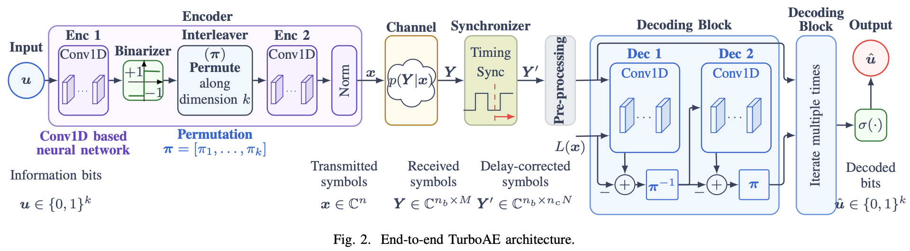

# Turbo Autoencoder vs. Finite-Blocklength Bound

[](https://www.python.org/) [](https://pytorch.org/) [](https://nvlabs.github.io/sionna/) [](LICENSE)

Source code, trained model, and parameter settings for the paper

> **Learning Joint Synchronization, Channel Estimation, and Decoding: Comparison with a Finite-Blocklength Achievability Bound**<br>
> Bingcheng Chen, Giuseppe Durisi, Christian Häger.<br>
> Department of Electrical Engineering, Chalmers University of Technology

## Contents

1. [Overview](#1-overview)
2. [Installation](#2-installation)
3. [Repository Structure](#3-repository-structure)
4. [Inference with the Pretrained Model](#4-inference-with-the-pretrained-model)
5. [Training from Scratch](#5-training-from-scratch)
6. [5G Baselines](#6-5g-baselines)
7. [Citation and Acknowledgements](#7-citation-and-acknowledgements)
8. [License](#8-license)

## 1. Overview

Learned schemes that jointly perform synchronization, channel estimation and decoding are promising for short-packet communication, but it is unclear how close they are to information-theoretic bounds. In this repository, we answer that question for one concrete setting. It extends the serial turbo autoencoder (TurboAE) of [Dörner et al. (2023)](#related-work) to a single-input single-output **waveform channel with an unknown delay and memoryless block fading**, a channel for which a finite-blocklength achievability bound (the pilot-assisted RCUs bound) is available.

The learned scheme uses **no dedicated pilots**. A model-guided neural synchronizer estimates the delay directly from the received samples, and the encoder, synchronizer, and decoder are trained end to end.

**Setting used in the paper.** $k = 64$ information bits, $n = 64$ complex channel uses (rate 1 bit per channel use), $n_b = 4$ Rayleigh fading blocks, common delay $d \sim \mathcal{U}(0, 4T)$, rectangular pulses, and 8× receiver oversampling.

**Main findings.**

- The proposed TurboAE achieves a lower BER than all evaluated pilot-assisted 5G baselines, with gains of $1.9$ dB at a BER of $10^{-3}$ over a baseline involving a LDPC code and $1.7$ dB over a baseline involving a polar code and SCL decoding (list size $8$). 

- In BLER, the TurboAE outperforms the LDPC-coded baseline, but lags behind the polar-coded baseline by about $0.8$ dB at a BLER of $10^{-3}$. 
- All evaluated schemes remain at least $2.1$ dB away from a pilot-assisted achievability bound, indicating substantial room for improved designs.

### Pipeline



### Results of the released model

The checkpoint in [trained_models/](trained_models/) uses the *TurboAE – BCE (CRC)* configuration from Fig. 4 of the paper: BCE loss, a 3-bit CRC, and CRC-aided selection among 8 candidates. The numbers below come from its evaluation log ([output.log](trained_models/Turbo_AutoEncoder_k64n64_CRC3_20261012_08_17_54/output.log)), with $10^7$ random packets per SNR point. SNR is the average SNR per complex symbol ($\rho = E_s/N_0$). The delay error is in units of the symbol period $T$.

| SNR [dB] | BER | BLER | Delay MAE [T] |
| ---: | ---: | ---: | ---: |
| 10 | 2.29e-2 | 1.77e-1 | 0.076 |
| 12 | 7.00e-3 | 6.43e-2 | 0.042 |
| 14 | 1.91e-3 | 2.02e-2 | 0.025 |
| 16 | 4.94e-4 | 5.94e-3 | 0.017 |
| 18 | 1.26e-4 | 1.67e-3 | 0.014 |
| 20 | 3.38e-5 | 4.81e-4 | 0.014 |
| 22 | 9.12e-6 | 1.38e-4 | 0.013 |
| 24 | 2.13e-6 | 3.90e-5 | 0.014 |
| 26 | 6.45e-7 | 1.23e-5 | 0.014 |
| 28 | 2.20e-7 | 4.70e-6 | 0.014 |
| 30 | 5.78e-8 | 1.40e-6 | 0.014 |

## 2. Installation

**Requirements**

- Python 3.12 or newer
- A CUDA-capable NVIDIA GPU, strongly recommended for both training and evaluation. Everything also runs on the CPU, but slowly.
- A free [Weights & Biases](https://wandb.ai/) account. The TurboAE script logs every run to W&B (see the note in step 4).

**1. Clone the repository.** The pretrained checkpoint (about 15 MB) is part of the repository.

```bash
git clone https://github.com/chenbin234/Turbo-Autoencoder-vs.-Finite-Blocklength-Bound.git
cd Turbo-Autoencoder-vs.-Finite-Blocklength-Bound
```

**2. Create the environment.** The recommended way uses [uv](https://docs.astral.sh/uv/) and installs the exact versions pinned in [uv.lock](uv.lock):

```bash
# Install uv if you do not have it yet
curl -LsSf https://astral.sh/uv/install.sh | sh

# Create .venv with the locked dependencies (uv fetches Python 3.12+ if needed)
uv sync # add --no-dev to skip the development tools
source .venv/bin/activate
```

**3. Check the installation.**

```bash
python -c "import torch, sionna.phy; print('torch', torch.__version__, '| CUDA available:', torch.cuda.is_available())"
```

**4. Log in to Weights & Biases.**

```bash
wandb login
```

> [!NOTE]
> `src/train/train_turbo_ae.py` starts its W&B run with `mode="online"`, which takes precedence over the `WANDB_MODE` environment variable. 

## 3. Repository Structure

```text
.
├── src/
│   ├── models/
│   │   ├── serial_turbo_autoencoder.py    # TurboAutoencoderSync: encoder, decoder, end-to-end forward pass
│   │   └── components/										 # Components called by TurboAutoencoder
│   ├── channel/													 # Waveform channel
│   ├── train/
│   │   ├── train_turbo_ae.py              # Entry point and TurboAEConfig (all hyperparameters)
│   │   ├── trainer.py                     # Two-stage training schedule, validation, checkpointing
│   │   └── utils.py                       # Bit and synchronization losses, DDP setup, seeding
│   ├── inference/
│   │   └── inference_turboae.py           # Monte Carlo BER / BLER / delay-error evaluation
│   ├── features/
│   │   └── build_pytorch_dataset.py       # InfobitDataset: random information bits for evaluation
│   └── baseline/													 # Pilot-assisted 5G baselines
├── trained_models/
│   └── Turbo_AutoEncoder_k64n64_CRC3_20261012_08_17_54/
│       ├── Turbo_AutoEncoder_20261012_08_17_54_epoch700.pth  # Pretrained weights (k = n = 64, CRC-3)
│       └── output.log                                        # Console log of the training and evaluation run
├── pyproject.toml                         # Package metadata, dependencies, lint settings
├── uv.lock                                # Locked dependency versions
└── LICENSE
```

## 4. Inference with the Pretrained Model

There is a single entry point for training and evaluation, [src/train/train_turbo_ae.py](src/train/train_turbo_ae.py). All settings are fields of the `TurboAEConfig` dataclass at the top of that file; change a setting by editing its default value. Run every command from the repository root as a module (`python -m src...`), because the code imports the `src` package.

### 4.1 Quick evaluation

Two fields make the script evaluate a checkpoint instead of training:

```python
# src/train/train_turbo_ae.py, inside TurboAEConfig
pretrained: str | None = "./trained_models/Turbo_AutoEncoder_k64n64_CRC3_20261012_08_17_54/Turbo_AutoEncoder_20261012_08_17_54_epoch700.pth"
is_inference: bool = True  # skip training, only evaluate `pretrained`
```

The test SNR range is define as following

```python
# test SNR range
test_snr_low: float = 10  # dB
test_snr_high: float = 30  # dB
test_snr_interval: float = 2.0  # dB
test_data_samples: int = 10_000_000  # packets per SNR point, split across all GPUs
```

These are the defaults, so the pre-trained model is evaluated with:

```bash
python -m src.train.train_turbo_ae
```

## 5. Training from Scratch

### 5.1 Reproducing the paper

Set these fields in `TurboAEConfig`:

```python
pretrained: str | None = None  # start from random weights
is_inference: bool = False  # train, then evaluate
num_samples: int = 500  # packets per training pass
batch_size: int = 500  # initial batch size used in the paper
```

Then start training on one GPU:

```bash
python -m src.train.train_turbo_ae            # optional: --seed 2 (default)
```

or on several GPUs with DistributedDataParallel:

```bash
torchrun --standalone --nproc_per_node=2 -m src.train.train_turbo_ae --use-ddp
```

The remaining defaults are the paper settings. 

### 5.3 Outputs

- **Checkpoints** are written to `trained_models/Turbo_AutoEncoder_<timestamp>/Turbo_AutoEncoder_<timestamp>_epoch<N>.pth` every `save_every` epochs (default 700, i.e., only the final model). 
- **W&B** (project `Joint-detection-and-decoding-in-short-packet-communications`) receives, per epoch: training and validation loss, validation BER and BLER at `train_enc_snr_low`, and delay MSE and MAE. After training, it also receives the BER/BLER-versus-SNR tables. Note that you need to setup your own **W&B** project.

### 5.4 Configuration reference

The main `TurboAEConfig` fields and their counterparts in the paper:

| Paper | Field | Default | Meaning |
| --- | --- | ---: | --- |
| $k$ | `k`, `input_size` | 64 | Information bits per packet |
| $n$ | `n` | 64 | Complex channel uses per packet |
| $n_b$ | `nb` | 4 | Fading blocks per packet |
| $T$ | `tp` | 1 | Symbol period |
| $N$ | `N_up` | 8 | Receiver oversampling factor |
| $t_s$ | `ts` | 0.125 | Sampling period $T/N$ |
| $d_{\max}$ | `dmax` | 4 | Maximum delay, in units of $T$ |
| $\nu$ | `receiver_mmse_regularization` | 0.2 | Regularization of the delay correction, Eq. (26) |
| $\beta$ | `smooth_l1_beta` | 0.2 | Smooth-L1 threshold, Eq. (28) |
| $\alpha$ | `alpha` | 0.5 | Weight of the delay loss in the joint loss |
| $N_\text{step}$ | `epochs` | 700 | Total training epochs |
| $N_\text{pre}$ | `epochs_integrate_sync` | 500 | Epochs in stage 1 |
| $K_\text{Enc}$, $K_\text{Dec}$ | `num_train_enc`, `num_train_dec` | 100, 500 | Stage-1 encoder/decoder passes per epoch |
| $K_\text{SyncEnc}$, $K_\text{Sync}$ | `num_train_sync_enc`, `num_train_sync_block` | 50, 50 | Stage-1 encoder/synchronizer passes per epoch |
| $K_\text{JointEnc}$, $K_\text{JointDec}$ | `num_train_joint_enc`, `num_train_joint_dec` | 50, 100 | Stage-2 passes per epoch |
| – | `CRC`, `candidate_list_size` | 3, 8 | CRC length ($g(x) = x^3 + x + 1$) and list size |
| – | `F`, `num_iteration` | 30, 6 | Width of the interleaved feature maps, and decoder iterations |
| – | `learning_rate`, `sync_learning_rate` | 1e-4, 1e-4 | Adam learning rates |

## 6. 5G Baselines

The pilot-assisted 5G baselines are simulated with [Sionna](https://nvlabs.github.io/sionna/). Unlike the TurboAE script, both baseline scripts work without a W&B account in offline mode.

### 6.1 Rayleigh block fading with estimated timing and CSI (Fig. 4c–d)

[src/baseline/baseline_Oguz_SNN_zadoff_imperfSync_imperfCSI.py](src/baseline/baseline_Oguz_SNN_zadoff_imperfSync_imperfCSI.py) sends two Zadoff–Chu pilots per fading block and estimates the delay and fading gains jointly with the maximum-likelihood estimator of [Kislal et al. (2024)](#related-work). It then decodes as if the estimates were exact. The channel matches the TurboAE setting ($n = 64$, $n_b = 4$, $N = 8$, $d_{\max} = 4T$).

```bash
python -m src.baseline.baseline_Oguz_SNN_zadoff_imperfSync_imperfCSI \
    --modulation 32psk \
    --snr-db 10 12 14 16 18 20 22 24 \
    --wandb-mode offline
```

The code is chosen by the `code_picked` variable in `run_simulation()`. To reproduce each curve in the paper, combine it with the modulation below:

| Curve in Fig. 4 | `code_picked` | `--modulation` |
| --- | --- | --- |
| 5G LDPC BP-20 | `"ldpc"` (default) | `32psk` |
| 5G polar + CRC SCL-8 | `"polar_scl8"` | `32psk` |
| 5G polar + CRC SC | `"polar_sc"` | `16psk` |

### 6.2 AWGN with perfect synchronization (Fig. 4a–b)

[src/baseline/AWGN/baseline_modern_codes_awgn.py](src/baseline/AWGN/baseline_modern_codes_awgn.py) has no command-line options. Set `code_picked` (`"ldpc"`, `"polar_scl8"`, or `"polar_sc"`), `modulation` (`"4qam"`, i.e., QPSK as in the paper, `"8psk"`, or `"16qam"`), and the SNR grid `Es_snr_db` in `main()`, then run:

```bash
WANDB_MODE=offline python -m src.baseline.AWGN.baseline_modern_codes_awgn
```

### 6.3 Not included

- **The RCUs achievability bound** in Fig. 4 comes from [Kislal et al. (2024)](#related-work) and is not included here (see the author's github [repository](https://github.com/OguzKislal/FiniteBlocklengthInfoTheory_ImperfectSync)).
- **The TurboAE AWGN curve.** The TurboAE pipeline in this repository supports the block-fading channel with delay only. For TurboAE implementation under AWGN, see my other repositories under GitHub [profile](https://github.com/chenbin234).

## 7. Citation and Acknowledgements

If you use this code or the trained model, please cite the paper:

```bibtex
@misc{chen2026learning,
  author = {Chen, Bingcheng and Durisi, Giuseppe and H{\"a}ger, Christian},
  title  = {Learning Joint Synchronization, Channel Estimation, and Decoding: Comparison with a Finite-Blocklength Achievability Bound},
  year   = {2026},
  note   = {Code available at \url{https://github.com/chenbin234/Turbo-Autoencoder-vs.-Finite-Blocklength-Bound}}
}
```

Publication details will be added to this entry once the paper is published.

### Related work

This code builds on the following works. Please consider citing them as well.

- **TurboAE.**  Y. Jiang, H. Kim, H. Asnani, S. Kannan, S. Oh, and P. Viswanath, “Turbo Autoencoder: Deep learning based channel codes for point-to-point communication channels,” in *Advances in Neural Information Processing Systems*, Curran Associates, Inc., 2019. Accessed: Jun. 12, 2025. [Online]. Available: https://proceedings.neurips.cc/paper_files/paper/2019/hash/228499b55310264a8ea0e27b6e7c6ab6-Abstract.html
- **Serial TurboAE.**  J. Clausius, S. Dörner, S. Cammerer, and S. ten Brink, “Serial vs. Parallel Turbo-Autoencoders and Accelerated Training for Learned Channel Codes,” in *2021 11th International Symposium on Topics in Coding (ISTC)*, Aug. 2021, pp. 1–5. doi: [10.1109/ISTC49272.2021.9594130](https://doi.org/10.1109/ISTC49272.2021.9594130).
- **TurboAE with joint detection and synchronization** S. Dorner, J. Clausius, S. Cammerer, and S. Brink, “Learning Joint Detection, Equalization and Decoding for Short-Packet Communications,” *IEEE Transactions on Communications*, vol. PP, pp. 1–1, Jan. 2022, doi: [10.1109/TCOMM.2022.3228648](https://doi.org/10.1109/TCOMM.2022.3228648).
- **System model, pilot-based estimator, and RCUs bound.** A. O. Kislal, M. Rajiv, G. Durisi, E. G. Ström, and U. Mitra, “Is Synchronization a Bottleneck for Pilot-Assisted URLLC Links?,” *IEEE Transactions on Wireless Communications*, vol. 23, no. 12, pp. 17945–17958, Dec. 2024, doi: [10.1109/TWC.2024.3458090](https://doi.org/10.1109/TWC.2024.3458090).

- **Sionna**, used for the 5G baselines. J. Hoydis et al., "Sionna," 2022, <https://nvlabs.github.io/sionna/>.

## 8. License

This project is released under the [MIT License](LICENSE).

Questions and bug reports are welcome on the [issue tracker](https://github.com/chenbin234/Turbo-Autoencoder-vs.-Finite-Blocklength-Bound/issues).
